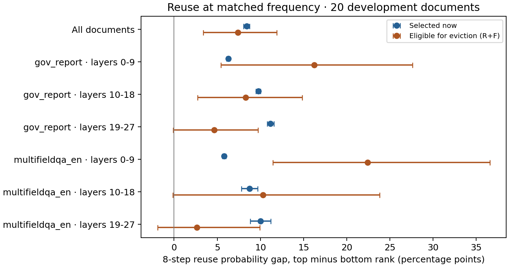

# 历史 rank 多常改变驱逐决定？

在个人 20 篇开发文档上，历史 rank 对复用有预测力。固定频率权重 β=2 后，加上 rank 改变了 2.93% 的驱逐决定，完整回放少了 59 次重复 miss。这里的文档与用于选择权重的 dev 相同，所有数字作为机制分析。40 篇 held-out 留给下一阶段。

## 输入与对照

个人开发 ZIP 的固定 SHA-256 见[项目大纲](../../SOLO_PROJECT_PLAN.md)。GovReport 和 MultiFieldQA-en 各 10 篇，每任务在两个长度段各 5 篇。每篇 28 层，每层 127 个 decode 步，共 71,120 个文档–层–步。K=64，每层 B=128。主对照是 recency + frequency（R+F，β=2）和增加 top-16 奖励 δ=4 的策略；补充对照取 β=0。两策略使用同一条访问序列和同一套平局规则。

## 排名与随后 8 步的复用

对本步选中的 page，使用本步排名；在 R+F 实际发生驱逐的步，对原先驻留、本步未选中的候选 page，使用上次入选的排名。Top 为第 1–16 名，bottom 为第 49–64 名。根据第 t−8 至 t−1 步的访问次数（0–8）分层，按同层 top 和 bottom 的总观测数加权两组概率差。样本只要求完整的未来 8 步；缓存从空状态启动，开头的频率只计实际历史。每个文档–层的末 8 步不参加复用统计，但仍参与完整回放。

| 样本 | 有共同频率层的 top + bottom 观测数 | 8 步复用概率差 | 95% 文档 bootstrap CI |
|---|---:|---:|---:|
| 本步入选的页 | 2,132,480 | +8.41 个百分点 | [+8.06, +8.74] |
| R+F 实际驱逐时的候选页 | 1,480,830 | +7.39 个百分点 | [+3.36, +11.90] |

在有完整窗口的 2,262,610 个驱逐候选观测中，只有 26,326 个（1.16%）上次入选排在前 16。这里每个 page 每出现于一个候选集合就计一次。两表只控制过去访问次数，最近一次访问的时间仍可不同。置信区间按任务 × 长度段分层，重采样整篇文档 2,000 次，随机种子 0。各任务 × 层组的估计及区间在 [reuse_summary.csv](reuse_summary.csv)。



## 实际驱逐与独立回放

每次基线需要驱逐时，用相同的驱逐前状态分别算两个策略会换出哪些页。只要集合不同，该步计为一次改选。随后沿基线的选择继续前进，使未来状态的差异不会混入本步的决策统计。对有完整窗口的改选，比较各自独有的保留页集合中谁最早被选中；一次换多页也只计一个结果。

| 基线 | 驱逐步 | 加 rank 后改选 | 改选率（95% CI） | 有完整窗口的改选 | rank 方先用 / 基线方先用 / 同步 / 两边均未用 |
|---|---:|---:|---:|---:|---|
| R+F，β=2 | 35,975 | 1,053 | 2.93% [2.41%, 3.45%] | 975 | 302 / 204 / 61 / 408 |
| LRU，β=0 | 35,974 | 1,160 | 3.22% [2.67%, 3.77%] | 1,069 | 340 / 228 / 72 / 429 |

最后让每个策略各自维护缓存，独立跑完全部 127 步。R+F 与 R+F+rank 分别有 82,088 和 82,029 次 repeat miss，少 59 次（0.072%）；LRU 与 LRU+rank 为 82,274 和 82,209 次，少 65 次。四个计数与个人 checkout 已存的 dev 网格一致。改选后率先用到某一页，只度量局部选择；每次调整也会影响后续多步的驻留状态，所以整段 miss 节省量须独立测量。

## 复现

从分支根目录运行，使用本地 Python 3.13、NumPy 和 Matplotlib。

```bash
python3 validation/rank_decisions.py "$HOME/Downloads/h2-development-20261120T045605Z.zip" --out docs/results/solo_rank_dev
python3 -m pytest -q
```

[rank_strata.csv](rank_strata.csv) 保存每个文档、层、样本和频率层的 top/bottom 计数及复用数。[event_counts.csv](event_counts.csv) 保存每文档、每层、每种基线的驱逐和完整回放计数。[decision_summary.csv](decision_summary.csv) 汇总决策比例和区间。测试覆盖四种先用结果、末尾窗口、频率窗口与独立参考的一致性。75 项测试通过，已有的零 oracle 差距合成测试仍产生一条 NumPy warning。
