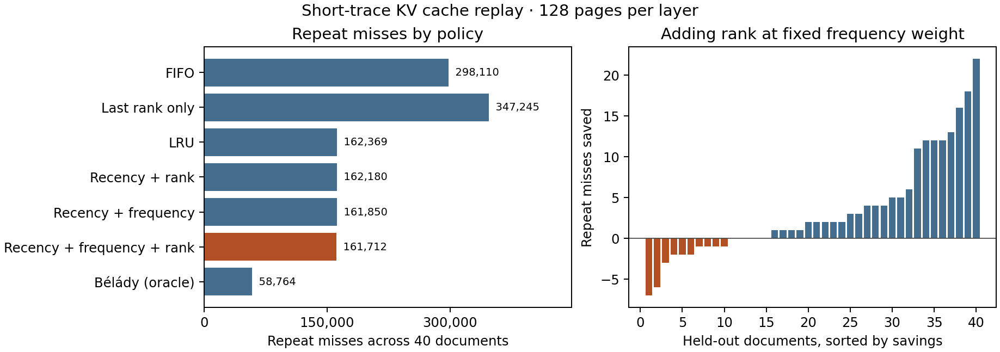

# 历史排名的 held-out 策略比较

在个人 40 篇短 trace 的主预算 B=128 上，完整策略相对 LRU 节省 657 次重复加载（0.405%），低于 proposal 的 10% 目标。固定频率权重后，历史排名额外节省 138 次，配对文档 bootstrap 95% CI 为 [65, 215]。在 B=256 的次要预算上仅节省 12 次，区间跨零。

## 设置

从个人原始 ZIP 本地回放。Qwen3-0.6B，Quest 选择器，28 层，16 token/page，K=64。GovReport 与 MultiFieldQA-en 各有两个上下文长度段（4–8K、8–16K），每个任务 × 长度段含 5 篇开发文档、10 篇 held-out 文档。开发集 A100、held-out L4，均为 BF16；同一文档的所有策略使用完全相同的历史页面选择。每篇 127 个 sparse decode 步，held-out 共 5,080 步、9,103,360 次页面访问。当前回放复现已经评估过的 40 篇文档。

开发集以 B=128 的总 misses 在 {0,1,2,4,8}² 中调参，平局依次选 δ+β 和 δ 较小的一组。25 行的全部计数与原个人归档一致。仅用频率的最优 (δ, β)=(0,2)，仅向 recency 加 rank 的最优为 (2,0)，完整策略为 (4,2)。B=256 使用同一组权重。历史 rank-only 按上次名次挑选牺牲页，平局沿用 LRU 顺序；R+rank 则在 recency 上为前 16 名加分。

## 策略主表

所有策略在每个预算下均有 225,680 次首次 miss。需求传输以每次 miss 加载 64 KiB 计算，除以 sparse decode 步数。该列仅估计读取量，硬件计时单独测量。

| 策略 | B=128 总 miss | B=128 重复 miss | B=128 需求 MiB/token | B=256 总 miss | B=256 重复 miss |
|---|---:|---:|---:|---:|---:|
| FIFO | 523,790 | 298,110 | 6.4443 | 247,139 | 21,459 |
| LRU | 388,049 | 162,369 | 4.7742 | 231,884 | 6,204 |
| 历史 rank-only | 572,925 | 347,245 | 7.0488 | 242,435 | 16,755 |
| Recency + frequency | 387,530 | 161,850 | 4.7678 | 231,884 | 6,204 |
| Recency + rank | 387,860 | 162,180 | 4.7719 | 231,874 | 6,194 |
| 完整策略 | 387,392 | 161,712 | 4.7661 | 231,872 | 6,192 |
| Bélády | 284,444 | 58,764 | 3.4996 | 225,789 | 109 |

在 B=128 上，LRU 到 Bélády 的绝对总 miss 率差为 1.138 个百分点（4.263% 和 3.125%），相对 LRU 总 miss 的可改善比例为 26.70%。完整策略填补该差距的 0.634%。B=64 时每一步结束都只驻留当前选择的 64 页，7 种策略逐文档逐层与相邻选择集合差的直接计算一致，总 miss 均为 1,498,591。



## 文档配对比较

沿用原个人 H2 分析：按任务 × 长度段在四个组内重采样整篇文档，每轮保留原组大小、所有策略用同一份抽样。共 10,000 轮，seed 20261119，取百分位区间。正值表示完整策略少发生重复加载。

| B | 对照 | 节省次数 [95% CI] | 相对对照降幅 [95% CI] | 文档改善 / 持平 / 变差 |
|---:|---|---|---|---|
| 128 | LRU | 657 [265, 1,058] | 0.405% [0.161%, 0.670%] | 27 / 2 / 11 |
| 128 | Recency + frequency | 138 [65, 215] | 0.085% [0.041%, 0.131%] | 25 / 5 / 10 |
| 256 | LRU | 12 [−1, 27] | 0.193% [−0.017%, 0.399%] | 6 / 32 / 2 |
| 256 | Recency + frequency | 12 [−1, 27] | 0.193% [−0.017%, 0.399%] | 6 / 32 / 2 |

B=128 下完整策略相对 LRU 减少的 657 次中，519 次来自加入频率，138 次来自在其上加入 rank。10% 实用目标未达到；H2 的独立判据（相对频率对照节省次数的区间下界大于零）满足。前一步的[开发集驱逐分析](../solo_rank_dev/README.md)表明固定 β 后 rank 只改变 2.93% 的驱逐决定，可解释这里收益的量级。

## 仓库原版实验与 selector 质量

原版也有 20 篇 dev 和 40 篇 held-out，参数单独冻结。下列数字取自仓库已有的[策略评估](../heldout/eval/success.json)与[质量评估](../heldout/longbench/longbench_summary.json)。个人 trace 的主表单独计算。

- 原版 B=128 相对 LRU 的重复加载降幅为 0.386%（95% CI 0.196%–0.572%）。完整策略 (8,2) 对频率策略 (0,4) 节省 330 次 [83, 600]；这两个配置的 β 也有变化。
- 原版 GovReport 的 sparse/dense ROUGE-L 分别为 17.42/18.70，配对差 −1.28 分，95% CI [−2.31, −0.18]。MultiFieldQA-en 的 F1 为 11.65/12.42，配对差 −0.77 分，95% CI [−1.89, 0.30]。这项对照反映稀疏选择对任务质量的影响。本轮替换实验固定了稀疏访问序列。

## 复现与输出

从分支根目录运行，使用 Python 3.13、NumPy、Matplotlib。

```bash
python3 validation/short_policy_eval.py "$HOME/Downloads/h2-development-20261120T045605Z.zip" "$HOME/Downloads/heldout-20261120T043814Z.zip" --out docs/results/solo_short_heldout
```

[开发网格](development-grid.csv) · [权重与输入哈希](replay-lock.json) · [840 行逐文档结果](per-document.csv) · [全预算主表](policies.csv) · [配对区间](paired.csv)
