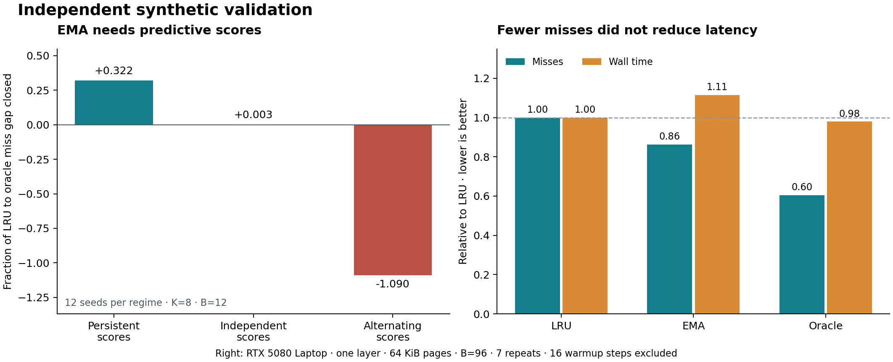

# Evaluation of rank kv cache efficient policy

Evaluated on 2026-11-23, from `efficient-policy` commit `24e5018341f0a0910a2c6e7f41bd7081522a2bc0`. Validation branch: `validation/comprehensive-systems-evaluation-2026-11-23`.

**Verdict:** the score-EMA replacement mechanism is correct in the tested simulator and synchronous GPU path, and it can reduce misses when current page scores predict future selections. It has no general advantage over LRU, and fewer misses do not establish a latency improvement. The shipped implementation was slower with EMA in the independent synthetic GPU measurement. Several evaluation-integrity defects need correction before extending the experiments or relying on automated reproductions.

This branch adds an independent test suite, executable CPU and GPU experiments, raw measurements, and this evaluation. Production Python and notebook implementations are unchanged so the findings remain reproducible. A `.gitattributes` rule fixes JSON checksum portability. The external long-context traces and original GPU artifacts were excluded at the user's request.

## Findings requiring correction

P1 means a defect can compromise an evaluation or its reproducibility. P2 means a substantive correctness or measurement defect with narrower impact. P3 covers edge-case robustness. None of these findings establishes that the published held-out experiment actually contained leakage or used different parameters.

| ID | Priority | Finding and consequence | Reproduction and remedy |
| --- | --- | --- | --- |
| F1 | P1 | `heldout.py:26–32,95` ignores `frozen["alpha"]`. Both uniform EMA and allocated EMA use module-level `ALPHA`. Editing or supplying a different frozen file does not control the evaluated policy. | A frozen B=96 alpha of 0.123 still runs with 0.5. Read and validate every parameter from the frozen artifact; record its hash with the results. The committed file currently agrees with the constants, so this does not by itself invalidate its reported run. |
| F2 | P1 | `heldout.py:83–84` checks development overlap by filename only. It neither enforces the 21-document membership list nor validates internal IDs, unique contexts, completeness, or the trace/model provenance. `assert` also disappears with optimized Python. | A development document saved as `renamed.npz` passes evaluation. Match internal `rid` and context identity to the frozen split, require exactly the expected documents/layers, reject duplicates, and use explicit exceptions. Apply the same discipline to `freeze`, which currently consumes any NPZ folder. |
| F3 | P1 | `checks.py:92–103` treats any completed row for `(config, B)` as completion of that configuration across all documents. After an interrupted append, rerunning can skip every missing document. | A file containing only document A prevents scheduling missing document B. Check completion per document/config/budget/layer, write complete units atomically, and reject incomplete aggregate tables. Otherwise missing counts can enter the default dictionaries as zero. |
| F4 | P2 | `efficient_dev.py:127–133` computes AUC from ordinal ranks without averaging ties. The result can depend on observation order, especially for age, counts, and discrete ranks. | Four identical scores yield AUC 1.0 for labels `[0,0,1,1]` and 0.0 for the reverse; both should be 0.5. Reuse the tie-aware implementation in `gap_analysis.py:231` or a checked equivalent. This affects mechanism diagnostics, not the miss-count arithmetic. |
| F5 | P2 | `kvpolicy.py:174–177` omits the hit/miss component of the LRU tie-break in `RankFull`. Its zero-weight baseline differs from both `LRU` and the older `replay.py` score policy. | With selections `[[0,2],[1,2],[3,0],[2,3]]` and B=3, LRU has 4 misses while rank with both weights zero has 5. Include `self.hit[p]` before the page-ID tie. Rank ablations otherwise change both the signal and the baseline ordering. |
| F6 | P2 | `kvpolicy.py:439–481` does not validate the NPZ schema as the JSONL reader does. It truncates fractional IDs to integers, silently collapses duplicate IDs into a set, and accepts selected-page NaNs. | The tests exercise duplicates, fractional IDs, and nonfinite selected scores. Validate integer unique IDs, dimensions, widths, eligible-page scores, ID bounds, and metadata at the ingestion boundary. Reject malformed arrays before simulation. |
| F7 | P2 | `gpu_bench.py:224–260` retains the prefill `ModelOutput` in `out` after `del cache`. The complete prefill cache remains alive at the peak-memory reset and into the first tiered decode call. | A real CUDA weak-reference probe finds the original cache and all four original K/V tensors alive at entry to the first decode of a two-layer model. Release the output and remaining views before resetting decode memory statistics. Report prefill, migration, and steady decode peaks separately. This is a lifetime/measurement issue, not a persistent cache leak. |
| F8 | P2 | `gpu_bench.run` accepts `warmup=8` but never uses it. It returns every latency sample and aggregates all misses. | Four decode steps with `warmup=2` return four latency samples. Define raw and steady-state metrics explicitly, apply the exclusion consistently, or remove the misleading argument. The unpublished outer harness might have sliced correctly; this audit cannot determine that. |
| F9 | P3 | `kvpolicy.py:507–570` does not consistently reject infeasible allocation inputs; proportional allocation also crashes when all weights are zero. | Greedy allocation can exceed a total smaller than the minimum feasible allocation; zero weights produce a scalar indexed as an array. Validate the grid/total and return a feasible minimum allocation for zero weights. The committed plans themselves are feasible. |

All nine defect groups have executable regressions in [test_contracts.py](test_contracts.py) and [test_gpu_contracts.py](test_gpu_contracts.py). Their 13 failing cases are marked **strict expected failures**, preserving a clear distinction between working contracts and unresolved defects. [Running with xfail disabled](results/defect_reproductions.txt) produces 13 ordinary failures and 43 passes.

Two additional reproducibility problems are addressed or documented:

- **Windows checkout hashes:** the initial checkout produced 63 passes and two failures because `core.autocrlf=true` changed the split bytes. The Git blob hash exactly matched preregistration. Restoring LF yielded all 65 upstream passes. `.gitattributes` now pins JSON line endings; no split values or committed split hashes changed.
- **Test discovery:** the README's `unittest discover` command runs 50 tests and omits the 15 pytest cases for `kvpolicy.py`. Use `python -X utf8 -m pytest`. UTF-8 mode is also needed on this machine because its default text encoding is GBK and several repository readers omit an encoding.

## What was independently verified

| Area | Result | Scope |
| --- | --- | --- |
| Existing suite | 65 passed after the LF correction | Existing replay, analysis, split, preregistration, truncation, and policy checks |
| Combined validation suite | **108 passed, 13 expected failures** | 65 upstream plus 43 passing independent cases; unresolved defects remain visible |
| Offline oracle | All 3,888 cases matched exhaustive state enumeration | 1,296 four-step traces at each of three budgets |
| EMA implementation | 24 parameterized cases matched a separately written scalar state reference, including exact eviction sequences | Eight seeds and three alpha values |
| Online causality | All 12 online policy families produced the same prefix decisions with or without future input | No oracle information entered these tested policy paths |
| Split and allocation artifacts | 14 dev and 21 held-out IDs; no overlapping recorded context identifiers; feasible 28-layer plans | Internal consistency of committed metadata, not authentication of unavailable traces |
| GPU page cache | 18 runs had exact resident K/V contents, zero attention error, identical rankings, and exact simulator miss counts | LRU/EMA/Bélády, B=64/96, three initial page offsets, 40 steps, actual 64 KiB pages |
| Model integration | Nine tiered runs matched resident tokens and rankings | Randomly initialized two-layer Qwen3; three prompt lengths, three policies, 24 decode steps |
| Capture integration | Long-trace capture matched the benchmark's rankings/tokens | Additional tiny-model check; notebook selector also passed its brute-force reference checks |
| Historical rank results | Both committed held-out tables and success files recomputed exactly from per-document counts | 40-document full and truncated evaluations; raw captures were not replayed |

The complete suite has one upstream warning: a synthetic smoke case has no LRU–oracle gap, so the bootstrap is all NaN. An undefined G should be reported as unavailable, not as statistical evidence.

Evidence is in [test_results.txt](results/test_results.txt), [cpu_experiments.json](results/cpu_experiments.json), and [gpu_experiments.json](results/gpu_experiments.json). CUDA tests used an NVIDIA RTX 5080 Laptop GPU, Windows 11, PyTorch 2.7.1+cu128, Transformers 4.53.3, and BF16. The original Triton zero-copy path was inspected but **not executed** because Triton was unavailable in this Windows environment.

## Why the method can work

Each step selects K historical pages. Every selected page must be loaded, and all selected pages are protected while the policy evicts only unselected residents. Consequently, changing a replacement policy can change transfers without changing the attended KV values. Exact copying and consistent token order are the important correctness conditions; the tested GPU path satisfied them.

LRU remembers only the most recent selection time and its tie state. Score EMA also observes the current selector scores of residents that have dropped out of the top K. A page just below the cutoff can plausibly return sooner than a page whose relevance has collapsed. The update is:

```text
z(page, t) = (score(page, t) - score(Kth, t))
             / (score(best, t) - score(Kth, t) + 1e-6)
ema(page) = alpha * ema(page) + (1 - alpha) * z(page, t)
```

Newly admitted pages start at the current z. The policy evicts the eligible resident with the lowest EMA, followed by deterministic LRU ties. Updating **all residents** lets formerly important pages lose their stale protection. Averaging can reduce short-term noise when score persistence lasts across multiple steps. Normalization makes the history less sensitive to changing score scales.

The score update needs one additional float per resident. That is a small algorithmic cost, but the GPU implementation also gathers scores, constructs masks, sorts tie keys, performs indexing, and launches multiple kernels. It is not a single FMA in elapsed time. `z` is also not globally bounded: unselected pages can be arbitrarily negative, and a nearly flat top-K score range magnifies the denominator sensitivity.

At B=K there are no spare residents to retain beyond the selected set. The GPU tests confirm that every policy has the same misses there. At sufficiently large B, all policies converge to compulsory misses. Useful replacement headroom lies between these extremes.

## When it fails and what the ablations establish

The following experiments use synthetic autoregressive score streams, not LongBench. They keep K=8, B=12, 32 pages, 400 steps, and 12 fixed seeds. The score correlation between adjacent steps is the controlled variable. G is `(LRU misses - policy misses) / (LRU misses - oracle misses)`.

| Score regime | LRU misses | EMA misses | EMA G | Seeds where EMA wins |
| --- | ---: | ---: | ---: | ---: |
| Persistent, correlation 0.98 | 1,743 | 1,576 | 0.322 | 12/12 |
| Independent, correlation 0 | 24,065 | 24,044 | 0.003 | 6/12 |
| Alternating, correlation -0.9 | 25,119 | 31,322 | -1.090 | 0/12 |

Persistence creates useful predictive information. With independent scores, the advantage nearly vanishes. With alternating scores, retaining pages that look good now can be actively harmful. Even in the persistent experiment, current-score eviction has 1,566 misses, slightly fewer than EMA's 1,576: smoothing is not always an improvement. A separate six-step counterexample has 4 LRU misses and 5 EMA misses, with the full scores recorded in the JSON artifact.

The project's explanation for rank-only failure is plausible but stronger than its ablation supports. `ScoreEMA(signal="rank")` assigns **zero to every unselected page**. Replacing z by that signal removes both score magnitudes and the ordering among unselected candidates. It therefore does not isolate whether cardinal score magnitude is necessary. A decisive additional comparison would give the policy every resident's current all-page rank or percentile, use the same update scope, and compare it with z. Likewise, F5 should be fixed before using the rank-policy row as a clean recency-plus-rank comparison.

FP16 score storage also matters: the CPU experiments found quantization changed miss counts by up to two in individual synthetic runs. The captured ranking can remain the original FP32 ordering while EMA consumes rounded scores. Exact live-versus-replay equality is therefore not guaranteed for near ties. This supports reporting numerical tolerances and both precisions rather than treating a small discrepancy as proof of incorrect transfers.

## Systems measurements and interpretation

The independent microbenchmark used the shipped synchronous tiered backend with 512 historical pages, 16 query heads, eight KV heads, head dimension 128, BF16, and 64 KiB per K/V page. Queries followed a synthetic correlation-0.98 process. Seven repeats used randomized configuration order, 192 steps each, and excluded the first 16 steps. All configurations saw identical queries/KV and selected the same pages. Raw per-step timings and misses are retained in [layer_benchmark.json](results/layer_benchmark.json).

| Configuration | B | Median layer time in ms | Range of repeat medians in ms | Misses after warmup per run |
| --- | ---: | ---: | ---: | ---: |
| LRU | 96 | 1.579 | 1.563–1.696 | 516 |
| EMA | 96 | 1.760 | 1.716–1.831 | 445 |
| Bélády | 96 | 1.546 | 1.502–1.581 | 312 |
| LRU | 128 | 1.493 | 1.471–1.583 | 353 |
| EMA | 128 | 1.675 | 1.660–1.728 | 297 |
| Bélády | 128 | 1.515 | 1.462–1.538 | 221 |
| Static resident selector and attention | All pages | 0.460 | 0.458–0.476 | 0 |

At B=96, EMA saves **13.8% of misses** but takes **11.4% more time**. At B=128, it saves **15.9% of misses** but takes **12.2% more time**. These are single-layer synthetic results on this laptop, not full-model token latency, statistical estimates across workloads, or a reproduction of the original L4 measurements. The static resident path retains all KV and has a different memory cost; it supplies a useful fixed-storage reference without HF's dynamic concatenation.

The separate large-buffer pinned H2D microbenchmark measured 53.6 GB/s. At B=96, EMA avoids 71 pages over 176 measured steps, about 26.4 KB per layer-step. At that bulk-copy rate the payload saving corresponds to only about **0.49 microseconds**, compared with roughly **181 microseconds of additional median layer wall time**. This is a scale estimate, not an additive accounting identity: small transfers, CPU gathering, synchronization, allocation, and kernel launches have their own costs. It explains why reducing traffic can coexist with a slowdown. PyTorch's guidance likewise distinguishes asynchronous-copy behavior from the synchronization needed before consuming results. [PyTorch transfer guidance](https://docs.pytorch.org/tutorials/intermediate/pinmem_nonblock.html)

The repository reports the same qualitative outcome on an L4: 86.6 ms/token for LRU versus 93.1 for EMA at B=96, and 8.50 versus 7.71 MB/token of H2D traffic. Those are **author-reported**, not locally reproduced values. Its documentation already acknowledges the absence of a latency win. [Original GPU report](../docs/gpu_benchmark.md)

Several limits matter when interpreting a systems claim:

- **GPU event or profiler duration is not fused end-to-end latency.** Summing kernel durations omits CPU gaps and can overcount concurrent work. Subtracting prefill from separate profiled totals also introduces measurement variation. The reported “launch-free” and batch-32 estimates are hypotheses for experiments, not measured implementations or universal speedup ceilings.
- **Memory measurement requires explicit phases.** F7 shows that resetting a peak counter does not release a live prefill cache. A two-tier implementation that first materializes the full cache on the GPU also cannot establish support for prompts whose prefill does not fit. Chunked/offloaded prefill would need separate implementation and testing.
- **The resident baseline needs fixed storage for a fair optimized comparison.** HF `StaticCache` preallocates storage, unlike the default dynamic cache. The layer microbenchmark uses preallocated storage, but no full-model static-cache integration was built in this audit. [Transformers 4.53.3 cache documentation](https://huggingface.co/docs/transformers/v4.53.3/en/kv_cache)
- **Batching is not implemented here.** The attention paths index batch element zero and are designed for one unpadded request. Increasing batch size requires cache ownership, selection, allocation, and scheduling changes; multiplying single-sequence traffic is insufficient evidence of a throughput gain.
- **No overlap was evaluated.** Hiding transfers behind compute can reduce the visible value of saving bytes. Conversely, shared PCIe or memory-bandwidth pressure can increase it. Both require measurements on the target system.



## Scientific and reproducibility assessment

The historical rank-study tables are internally reproducible from committed counts. On the original 40-document held-out test at B=128, the full rank/recency/frequency policy reduced repeat misses by only **0.386%**, closing **0.594% of the LRU–oracle gap**. The truncated evaluation gives 0.312% and 0.495%, respectively. Both fail the preregistered 10% repeat-miss-reduction criterion. The small rank increment over recency/frequency passes the separate statistical criterion, but is not a substantial systems result. This is distinct from the later dev-only rank G around 0.027 on the new long-context workload.

For the new score-EMA study, [the repository reports](../docs/heldout_results.md) G=0.281 with CI [0.277, 0.285] and 21/21 document wins; allocation plus EMA is reported at G=0.402. The frozen split and parameter artifacts exist, and the freeze commit precedes the result commit in Git history. However, the 21-document miss table and raw traces are not committed. `heldout.py eval` only writes `misses.csv`; it does not reproduce the reported success decisions, paired allocation CI, or final document-level report. Those steps need a committed aggregation command and input provenance. These headline values remain author-reported in this evaluation.

Other methodological boundaries are:

- **Appropriate resampling unit, narrow population.** The code resamples whole documents instead of treating tokens/layers as independent samples. That is appropriate for within-workload uncertainty, but 21 documents from two related summary tasks and one main model do not establish generalization across models, selectors, prompts, or serving systems. The synthetic failures demonstrate why that scope matters.
- **Allocation changes the oracle comparison.** G for allocated policies uses the uniform-budget LRU and uniform-budget Bélády anchors. That is a useful reference, but the denominator is not the full optimum under a flexible total-layer budget. A validation example shows that a reallocated LRU can beat uniform Bélády at the same total capacity. Compare against an allocation-aware oracle before claiming a fraction of all available systems headroom.
- **Replacement fidelity and model quality are separate.** Matching the resident sparse selector proves the tiering mechanism preserves that selector's output. It does not prove the sparse selector preserves dense-model quality. The committed rank-study quality checks do not establish quality for the later thinking-enabled long-context prompt family.
- **This is a Quest-style adaptation.** The repository averages bounds across query heads into one layer ranking; the original Quest evaluation code takes top-K while preserving its head dimension. Its performance and quality claims should not be identified with unmodified Quest. [Quest reference implementation](https://raw.githubusercontent.com/mit-han-lab/Quest/main/evaluation/quest_attention.py)
- **Proxy baselines have limited interpretation.** The InfLLM-style variants use softmax of selector bounds in place of actual attention mass. They compare related scoring rules under this trace format; they are not complete reproductions of the corresponding external systems. The repository itself appropriately narrows its novelty claim to comparison and measurement.
- **Algorithms and implementation costs differ.** Full score sorting, Python per-layer dispatch, dense page-to-slot tables, dynamic index operations, and host gathers are concrete costs. The O(B) EMA state description alone does not characterize the implemented policy latency or total metadata footprint.

## Completion criteria for the next systems experiment

The existing evidence supports keeping score EMA as a research candidate for reducing traffic. It does not support deploying this implementation for a latency improvement. The following sequence would resolve the remaining claims without changing the held-out protocol retrospectively:

1. Fix F1–F6, apply F7–F8 to the measurement harness, and remove each strict-xfail marker only when its regression passes. Add exact dataset membership, canonical hashes, model/tokenizer revisions, precision, selector settings, and environment versions to every saved result.
2. Commit the held-out aggregation script, including document-clustered CIs, all three success criteria, per-task tables, and explicit handling of zero oracle gaps. Preserve the original frozen artifact; a new experimental policy needs a new version.
3. Retain token, ranking, per-layer miss, and resident-content checks while optimizing. Test synchronous and zero-copy paths separately, including new-page completion, near ties, multiple streams, cache reuse across requests, and invalid input rejection. The current local evidence covers the synchronous single-request path.
4. Establish comparable fixed-storage resident and tiered baselines. Record time to first token, prefill/migration time, steady decode p50/p95/p99, request throughput, GPU allocated/reserved peaks, pinned host memory, and actual transfer bytes. Use identical selections and prompts, randomized paired run order, and several independent repeats.
5. Implement and test batch support before making batching claims. Sweep context length, K/B, batch size, page payload, precision, and at least two representative models. Measure contention and transfer overlap rather than extrapolating linearly from one sequence.
6. Fuse only after profiling the critical path. A real latency gain requires saved exposed transfer time to exceed added policy work. Keep traffic reduction and latency improvement as separate pass conditions; evaluate quality on the intended task when the selector or prompt changes.

The reproducible commands and evidence inventory are in [validation/README.md](README.md). This validation is complete for the accessible repository and the agreed local/synthetic scope; it does not certify the unavailable original long-context data or the unexecuted Triton implementation.
